# Nepal Civic — नागरिक गुनासो व्यवस्थापन

A grievance (गुनासो) platform built around Nepal's federal structure. Citizens report local problems such as broken roads, water supply or waste in Nepali or English. The grievance goes to their **ward office**. If the ward does not act before the deadline, it moves up automatically to the **Palika**, then the **District**, then the **Province**.

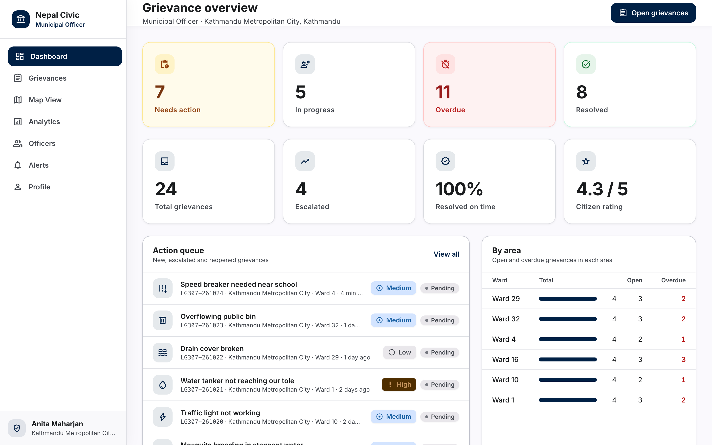

## Features

**Citizens** (mobile-first)
- Register with a Nepali mobile number and an SMS one-time code (Sparrow SMS)
- Report a grievance in 5 steps: category, details, Province → District → Palika → Ward, an optional map pin inside Nepal, and photos
- A reference number like `LG307-1042`, live status tracking, before/after photos, and notifications
- Confirm the fix, reopen it if the problem remains, and rate the service

**Officers** (one set of screens adapts to the officer's level)
- Ward, Palika, District and Province officers, plus a national administrator
- Each officer sees only their own area. The API enforces this, not just the UI
- A dashboard with an action queue, overdue count, on-time resolution rate and a per-area comparison
- Grievance list with search and filters; assign, change status (a note is required to resolve, reject or block), escalate, post public updates or internal notes
- Map of every grievance in the area
- Analytics: daily trend, categories, the level each grievance is held at, and resolution rate per area
- Officer accounts: create officers below your own level, reset passwords, deactivate accounts

**Built for Nepal**
- All 7 provinces, 77 districts, 753 local levels and 6,743 wards, with Nepali names
- Bikram Sambat dates (`10 Kartik 2083`), Nepali digits, and the Asia/Kathmandu time zone
- Standard Palika sections (शाखा) mapped to each category
- Deadlines by priority: critical 24 h, high 48 h, medium 72 h, low 5 days. Automatic escalation on a missed deadline; resolved grievances close automatically after 7 days
- Full English / नेपाली interface, switchable at any time

| | |
|---|---|
| 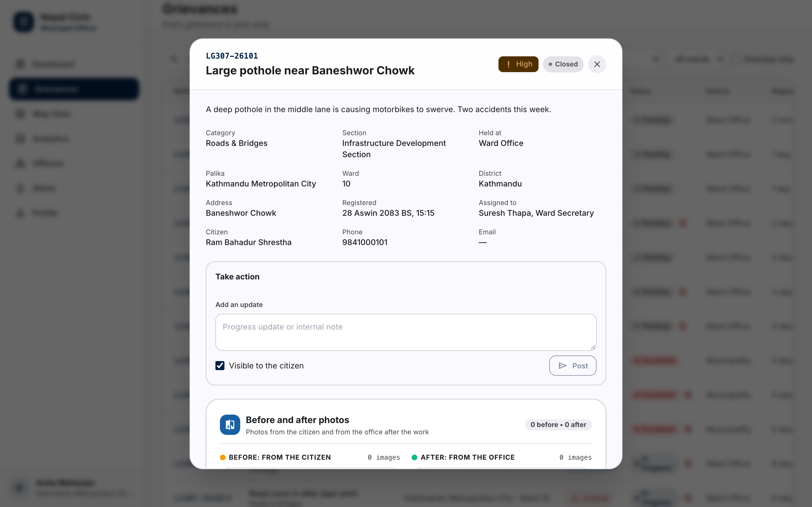 | 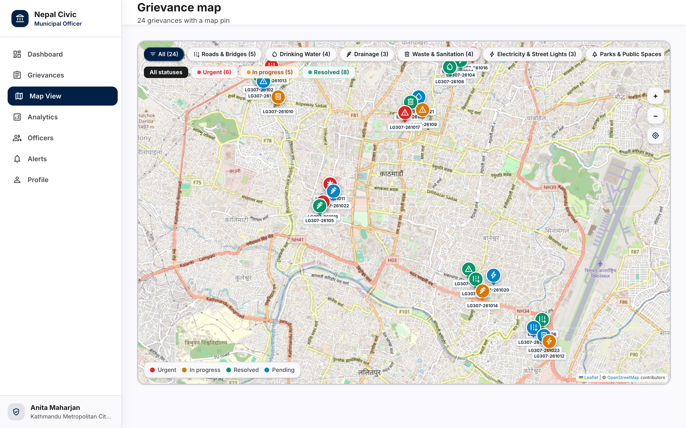 |
| 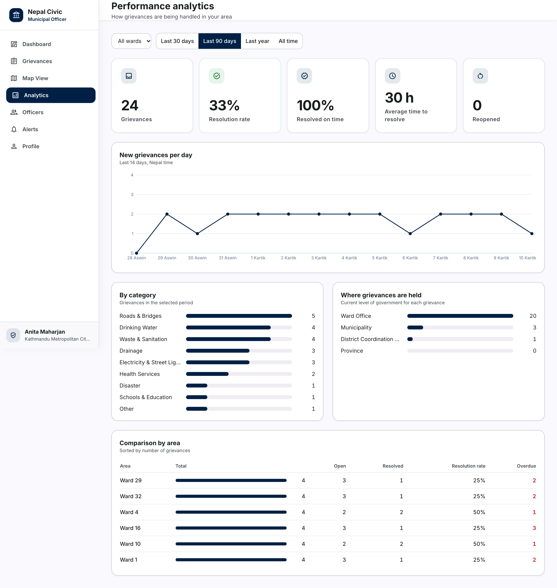 | 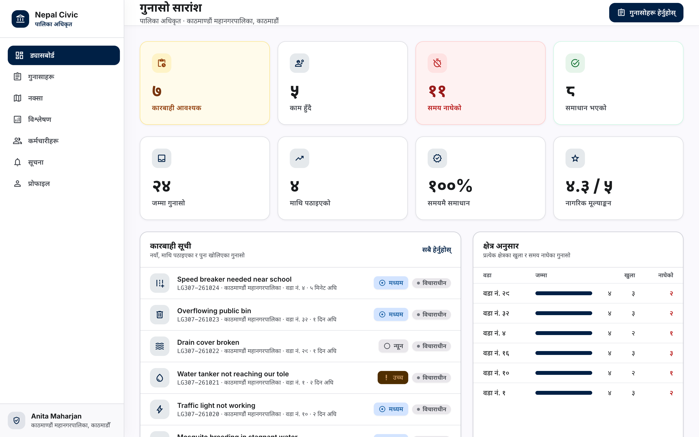 |
| 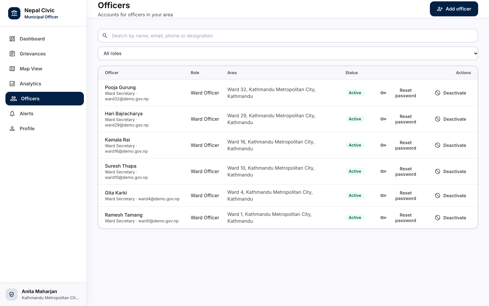 | 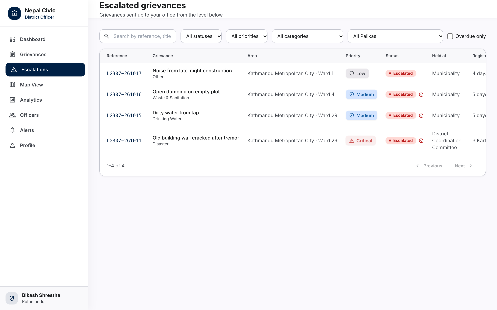 |

<p>
  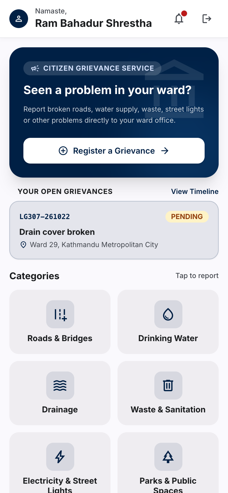
  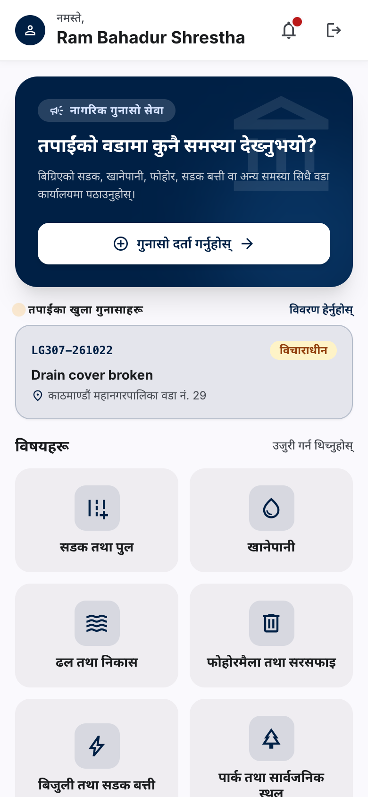
  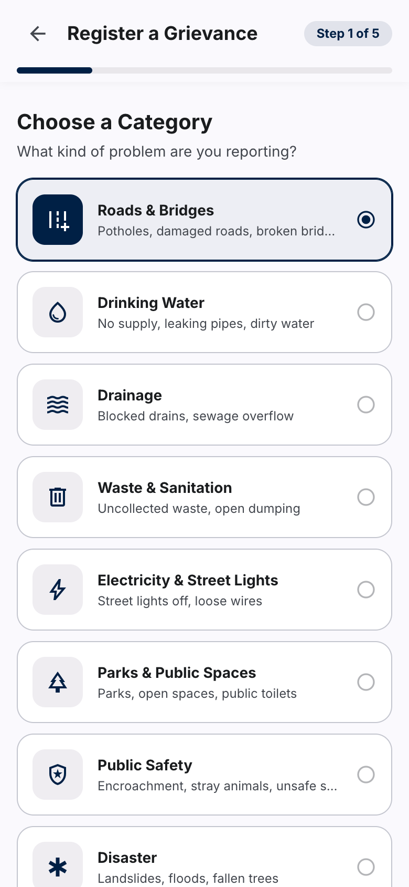
  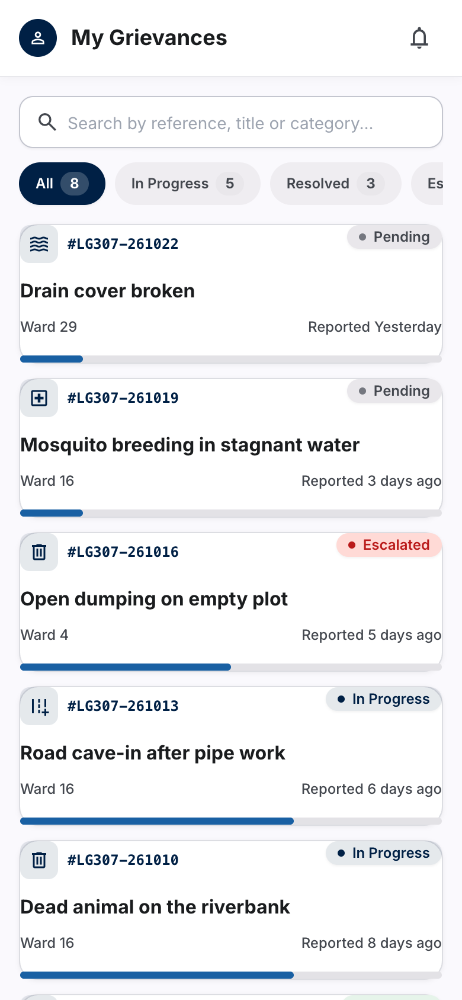
</p>

## Architecture

```
frontend/  React 18 · TypeScript · Vite · Tailwind · Leaflet · Recharts
   │  REST + JWT
backend/   Node.js · Express · TypeScript · Sequelize · PostgreSQL · inversify
   ├─ auth         phone OTP for citizens, email + password for officers, JWT, area scope
   ├─ grievances   create, assign, status, escalate, comments, stats, scheduler
   ├─ admin        officer accounts, limited to the manager's own area
   ├─ geo          provinces, districts, Palikas, wards
   ├─ storage      photo uploads (local disk or S3-compatible, signed links)
   └─ sms/email    Sparrow SMS, SendGrid
```

## Running locally

Requirements: Node.js 20 and PostgreSQL 13 or newer.

```bash
# 1. Backend
cd backend
cp .env.template .env            # set DATABASE_URL and AUTH_JWT_SECRET
npm install
npm run migrate up
npm run seed-nepal               # provinces, districts, Palikas, wards, categories
SUPER_ADMIN_PASSWORD='Admin@2083' npm run create-super-admin -- admin@example.gov.np Nepal Admin
npm start                        # http://localhost:3000

# 2. Frontend
cd ../frontend
cp .env.example .env             # VITE_API_URL=http://localhost:3000
npm install
npm run dev                      # http://localhost:5173
```

### Demo data

With the server running and `OTP_EXPOSE_IN_RESPONSE=1`, this loads officers, citizens and 24 grievances for Kathmandu Metropolitan City, spread over the last two weeks:

```bash
cd backend
API_URL=http://localhost:3000 ADMIN_EMAIL=admin@example.gov.np ADMIN_PASSWORD='Admin@2083' \
DATABASE_URL=postgres://... npm run seed-demo
```

Demo logins use the password `Demo@2083`:

| Role | Login |
|---|---|
| Province officer | `province@demo.gov.np` |
| District officer | `district@demo.gov.np` |
| Palika officer | `palika@demo.gov.np` |
| Ward officers | `ward1@`, `ward4@`, `ward10@`, `ward16@`, `ward29@`, `ward32@demo.gov.np` |
| Citizens | `9841000101`, `9801000102`, `9851000103` |

## Tests

```bash
cd backend
npm test        # 238 passing — auth, area scoping, escalation, SLA, admin rules, Open311
cd ../frontend
npm run build   # type-check and production build
```

## Configuration

Every backend setting is listed in [`backend/.env.template`](backend/.env.template). The important ones:

| Variable | Purpose |
|---|---|
| `AUTH_JWT_SECRET` | Signing key for login tokens |
| `SPARROW_SMS_TOKEN`, `SMS_FROM_IDENTITY` | Sending OTP and notification SMS |
| `ESCALATION_INTERVAL_MINUTES` | How often overdue grievances are escalated (0 turns it off) |
| `RESOLVED_AUTO_CLOSE_DAYS` | Days before a resolved grievance closes on its own |
| `STORAGE_DRIVER` | `local` or `s3` for photo uploads |

## Credits

The backend builds on [GovFlow](https://github.com/govflow/govflow) (MIT). See [NOTICE](NOTICE).
